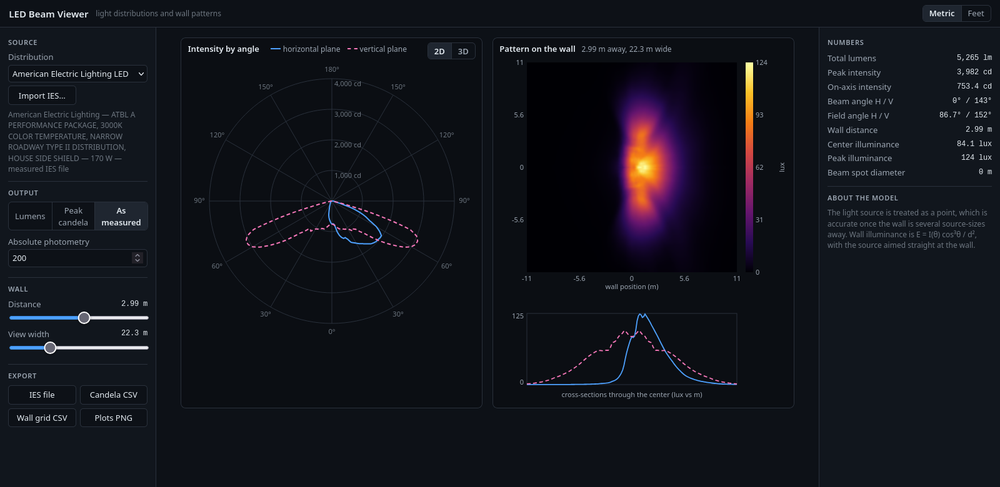

# LED Beam Viewer

A simple viewer for looking at LED light distributions.  You can select from a generated beam model, or a real ies file with measured data.  The polar intensity curve in 2d or 3d, the pattern it throws on a wall are plotted , and the photometric calculations will be displayed



*Measured data: an American Electric Lighting LED area light (LM-79-08 lab
report), loaded from the bundled IES library.*

## What it does

- **Polar intensity plot** in two orthogonal planes
- **Wall pattern**: a heat map of illuminance on a wall you can slide from
  0.2 m to 30 m away, with adjustable view width
- **Numbers**: total lumens, peak candela, beam/field angles, center and
  peak illuminance, spot diameter
- **Scaling**: by total lumens, by peak candela, or "as measured" for
  absolute photometry from real files
- **Units**: metric or feet/footcandles
- **Export**: IES LM-63 file, candela CSV, wall-grid CSV, PNG plots
- **URL presets**: deep links into a source, distance, and units

## Sources

- **Generated**: Lambertian (bare LED), cosⁿ narrow spot, batwing — with
  parameter sliders
- **Bundled library**: real measured LM-63 files (BEGA luminaires, an
  Acuity/AEL lab-tested LED area light, a 15° Xicato track spot, and a
  classic fluorescent example) — see `site/ies/LICENSES.md` for sources
  and licenses
- **Your own files**: *Import IES…* loads any `.ies` file locally;
  multi-file import is supported

## Try it live

**<https://led-beam-viewer.jonfblanchard.workers.dev>**

## Run it locally

```bash
./serve.sh                # http://localhost:8471 (bundled library loads over http)
./serve.sh 9000           # custom port
```

Opening `site/index.html` directly (`file://`) works too, but browsers
block `fetch`, so the bundled library is skipped — Import still works.


## Model

The source is a point with a candela table `I(theta, phi)`. Wall
illuminance follows `E = I(theta) cos^3(theta) / d^2` — exact for a point
source, and a good approximation once the wall is several source-sizes
away. Total lumens come from zonal-band integration; measured multi-plane
azimuth tables fold by their declared symmetry (quadrant, bilateral,
offset spans).

## Tests

```bash
node tests/test_core.cjs            # 13 analytic + regression checks
python3 tests/cross_check_lumens.py # independent Python re-integration of every bundled file
```

The cross-check re-parses each bundled IES file in Python and compares
lumens and interpolated candela against the JavaScript implementation —
two independent code paths over the same data.

## License

MIT for the code. Bundled `.ies` files retain their own terms — see
`site/ies/LICENSES.md`. All bundled files come from permissively-licensed
open-source repositories (three.js, appleseed, Radiance) and are real
laboratory photometric measurements.
